# Lumen: A Programming Language Interpreter with a Full Stack Web Playground


**Lumen** is a small, dynamically typed programming language with its own interpreter, written from scratch in Python, plus a **full stack web playground** for writing and running Lumen code in the browser.

- **Front end:** HTML, CSS and JavaScript code editor with syntax highlighting, line numbers, error markers, and Output / Tokens / Syntax tree views.
- **Back end:** a Flask **REST API** that runs programs safely (time and output limits) and exposes the lexer and parser.
- **Database:** **SQLite** stores programs users save, each with a shareable link.

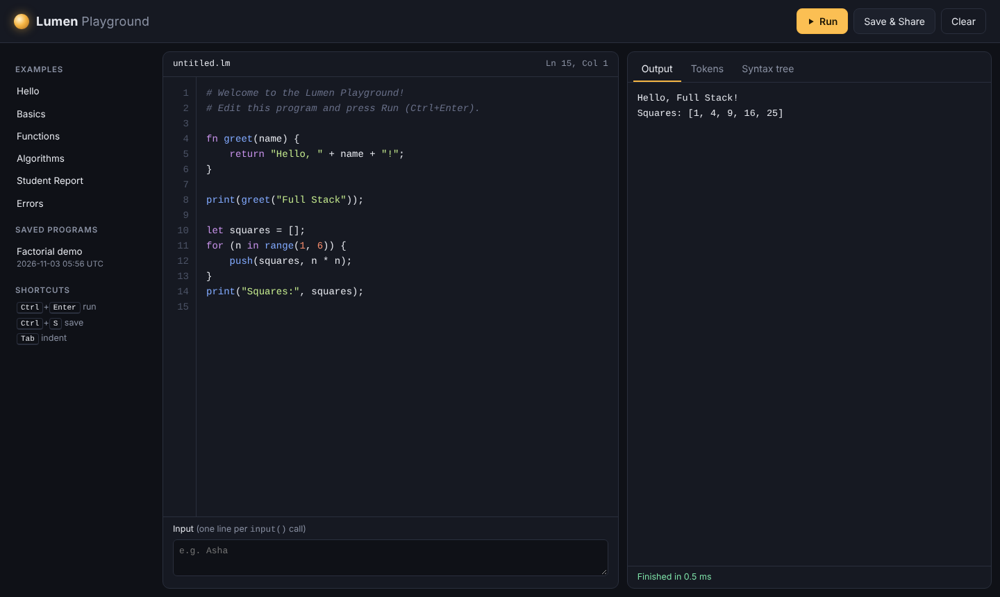

---

## Table of Contents

1. [Objective](#objective)
2. [Project Description](#project-description)
3. [Features](#features)
4. [Tools and Technologies](#tools-and-technologies)
5. [How It Works](#how-it-works)
6. [REST API](#rest-api)
7. [Project Structure](#project-structure)
8. [Execution Steps](#execution-steps)
9. [Output](#output)
10. [Testing](#testing)
11. [Future Enhancements](#future-enhancements)

---

## Objective

- Build a **full stack web application** with a browser front end, a REST API back end and a database.
- Understand how programming languages work internally by building one end to end: **lexical analysis, context-free grammars, recursive-descent parsing, abstract syntax trees, scoping and tree-walking evaluation**.
- Run untrusted user code on a server **safely**, with limits on time and output.
- Produce a working, tested and documented project.

## Project Description

Every programming language follows the same pipeline: source code is broken into **tokens**, the tokens are arranged into a **syntax tree** according to a **grammar**, and the tree is then **executed**. Lumen implements this pipeline in readable, commented Python with no external libraries.

On top of the interpreter sits the **Lumen Playground**, a web application in three tiers:

1. The **browser** sends the code in the editor to the server as JSON.
2. The **Flask server** runs it through the interpreter and returns the output, or the error with its line number. It can also return the token list and the syntax tree.
3. **SQLite** saves programs; each gets a short id, so `http://localhost:5000/?s=Yx-kQuiy` opens that program for anyone.

The interpreter also works on its own from the terminal: `python -m lumen program.lm` runs a file and `python -m lumen` starts an interactive shell. The full language reference is in [docs/LANGUAGE_GUIDE.md](docs/LANGUAGE_GUIDE.md).

```
fn factorial(n) {
    if (n <= 1) { return 1; }
    return n * factorial(n - 1);
}
print("10! =", factorial(10));      # 10! = 3628800
```

## Features

**Web playground**

| Feature | Details |
|---------|---------|
| Code editor | Syntax highlighting, line numbers, Tab to indent, cursor position |
| Run | Ctrl+Enter or the Run button; output, run time and errors shown in the console |
| Error markers | The line with the error is marked red in the editor's gutter |
| Input | A box supplies lines to `input()` calls |
| Learning views | **Tokens** tab (lexer output) and **Syntax tree** tab (collapsible AST) |
| Examples | Six sample programs load with one click |
| Save & Share | Saves to SQLite and copies a share link; recent saves listed in the sidebar |
| Safety | 3-second time limit (stops infinite loops), 2,000-line output limit, 20,000-character code limit |
| Responsive | Works on phone-sized screens |

**Language**

| Category        | What Lumen supports |
|-----------------|---------------------|
| Data types      | `int`, `float`, `string`, `bool`, `nil`, `list`, `function` |
| Variables       | `let` declarations, reassignment, block scoping, shadowing |
| Operators       | `+ - * / %`, comparisons, `== !=`, `and or not`, correct precedence and associativity |
| Control flow    | `if / else if / else`, `while`, `for (x in list)`, `break`, `continue` |
| Functions       | Named and anonymous functions, recursion, **closures**, higher-order functions |
| Lists           | Literals, indexing (including negative), index assignment, nesting, `+` and `*` |
| Built-ins       | `print input len str int float type range push pop join split sqrt abs clock` |
| Error handling  | Syntax and runtime errors with **line numbers**; stack-overflow protection |
| Terminal tools  | REPL with multi-line input; `--tokens` and `--ast` debug views |

## Tools and Technologies

| Layer | Technology | Purpose |
|-------|------------|---------|
| Front end | **HTML5, CSS3, JavaScript (ES6)** | Editor, highlighting, tabs, calls to the API with `fetch` |
| Back end | **Python 3.8+, Flask** | REST API, page serving, running the interpreter |
| Database | **SQLite** (`sqlite3` module) | Storing saved programs |
| Interpreter | Python standard library (`dataclasses`, `enum`) | Lexer, parser, AST and evaluator |
| Testing | `unittest`, Flask test client | 72 automated tests |
| Tools | Git, GitHub, VS Code | Version control, hosting, editing |

## How It Works

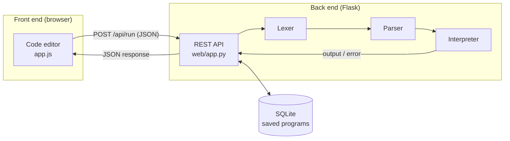

**1. Front end (`web/static/app.js`).** The editor is a transparent `<textarea>` laid over a `<pre>` that shows the highlighted code, so typing feels native while colours update on every keystroke. Run sends `{code, input}` to `/api/run` with `fetch` and renders the JSON reply. Error lines returned by the server are marked in the gutter.

**2. Back end (`web/app.py`).** Flask validates each request (JSON shape, code size) and runs the interpreter with limits: a **3-second time limit** checked every 1,000 steps, a **2,000-line output cap**, and Lumen's own 1,000-call recursion limit. Errors come back as structured JSON (`message`, `line`, `kind`), so the front end can point at the right line.

**3. Database (`web/database.py`).** A `snippets` table holds saved programs. Ids are random 8-character tokens from `secrets.token_urlsafe`, and every query uses **parameterised SQL**, so titles such as `'); DROP TABLE snippets; --` are stored as plain text.

**4. Interpreter (`lumen/`).** The lexer turns characters into tokens with line numbers. A **recursive-descent parser** builds an AST, with precedence coming from the grammar (`term` calls `factor`, so `*` binds tighter than `+`). The interpreter walks the tree: scopes are a linked chain of environments, closures keep the environment they were created in, and `return`/`break`/`continue` are exceptions that unwind to the right place.

## REST API

| Method | Endpoint | Request body | Response |
|--------|----------|--------------|----------|
| GET  | `/` | | The playground page |
| GET  | `/api/examples` | | `{examples: [{file, name, code}]}` |
| POST | `/api/run` | `{code, input}` | `{output: [...], error: null \| {message, line, kind}, time_ms}` |
| POST | `/api/tokens` | `{code}` | `{tokens: [{type, lexeme, line}]}` |
| POST | `/api/ast` | `{code}` | `{ast: [...]}` |
| POST | `/api/snippets` | `{title, code}` | `201 {id, title, created_at}` |
| GET  | `/api/snippets` | | `{snippets: [...]}` (10 most recent) |
| GET  | `/api/snippets/<id>` | | `{id, title, code, created_at}` or `404` |

Example:

```bash
curl -X POST http://localhost:5000/api/run -H "Content-Type: application/json" \
     -d '{"code": "print(6 * 7);"}'
# {"output": ["42"], "error": null, "time_ms": 0.2}
```

## Project Structure

```
.
├── web/                    # Full stack playground
│   ├── app.py              # Flask app: REST API + page
│   ├── database.py         # SQLite storage for saved programs
│   ├── templates/index.html
│   └── static/             # style.css, app.js (front end)
├── lumen/                  # The interpreter package
│   ├── __main__.py         # CLI: run files, REPL, --tokens / --ast
│   ├── lexer.py            # Source text  -> tokens
│   ├── parser.py           # Tokens       -> AST (recursive descent)
│   ├── interpreter.py      # AST          -> execution (with time limit)
│   ├── environment.py      # Variable scopes
│   ├── tokens.py, ast_nodes.py, values.py, builtins.py, errors.py
├── examples/               # Sample Lumen programs
├── tests/                  # 72 unit tests (interpreter + web API)
├── screenshots/            # Output screenshots
├── docs/LANGUAGE_GUIDE.md  # Full language reference
├── requirements.txt        # flask
└── README.md
```

## Execution Steps

**Prerequisite:** Python 3.8 or newer (`python --version`; on some systems use `python3`).

```bash
# 1. Clone the repository
git clone https://github.com/TheOne-ship/Lumen-interpreter.git
cd Lumen-interpreter

# 2. Install Flask (needed only for the web playground)
pip install -r requirements.txt

# 3. Start the web playground, then open http://localhost:5000
python -m web.app

# 4. Or use the interpreter from the terminal
python -m lumen examples/01_hello.lm      # run a file
python -m lumen                           # interactive shell (:quit to exit)
python -m lumen --tokens examples/01_hello.lm

# 5. Run the test suite
python -m unittest discover -s tests -t .
```

The playground creates `web/lumen.db` on first run. Set `PORT` or `LUMEN_DB` to change the port or the database file.

## Output

### Web playground

**Editor and output.** The starter program runs and prints its results.


**Running a larger example (algorithms).**
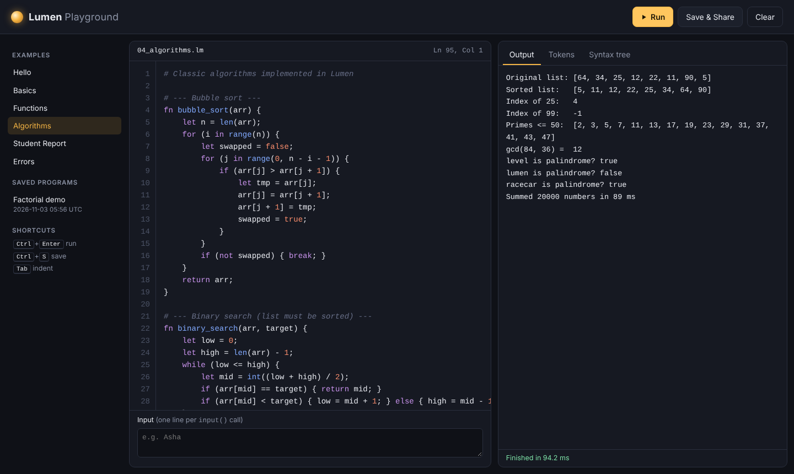

**Errors are marked on their line.**
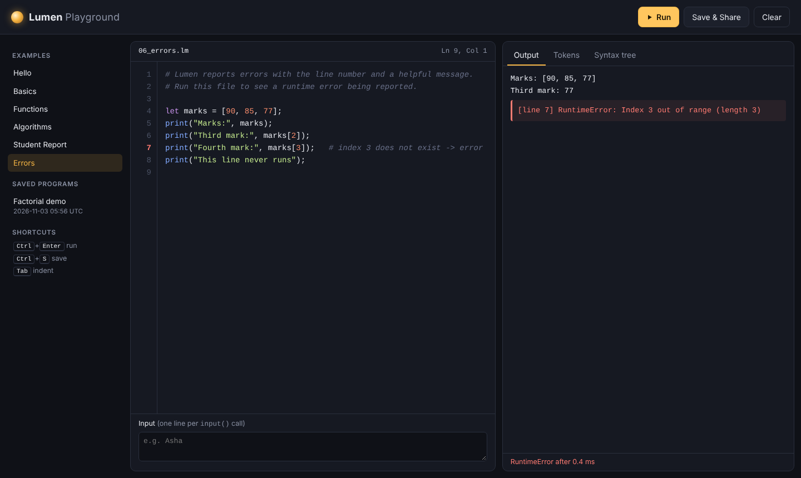

**Tokens view (lexer output).**
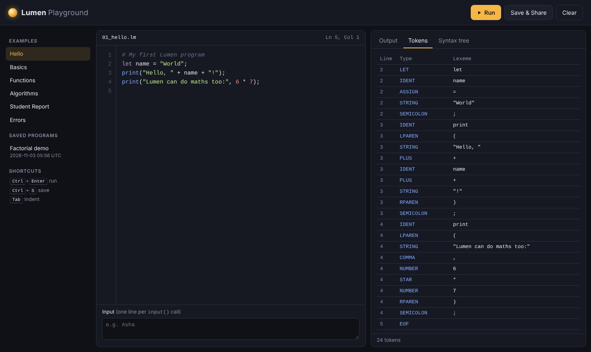

**Syntax tree view (parser output).**
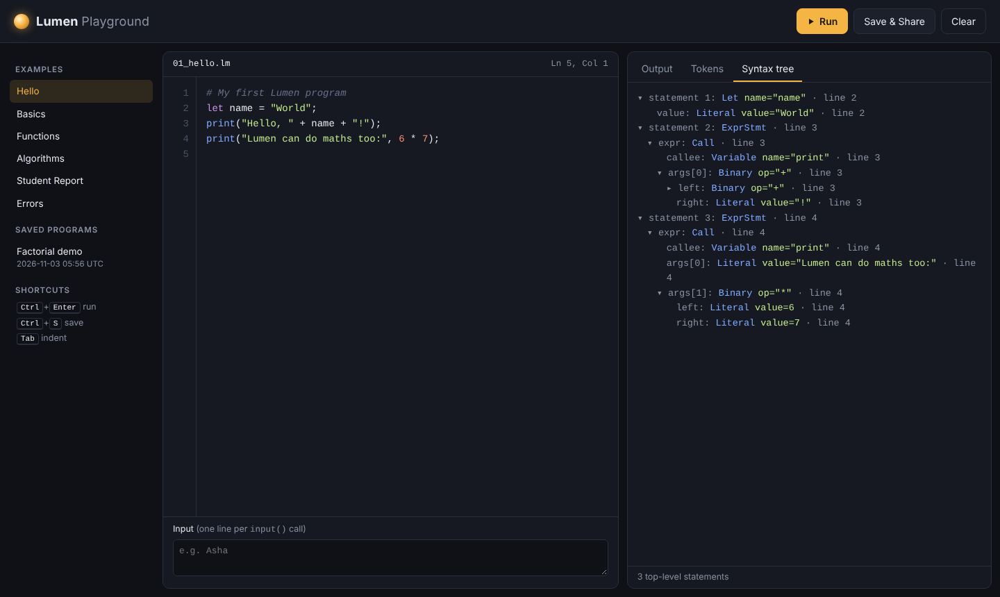

**Save & Share: stored in SQLite with a share link.**
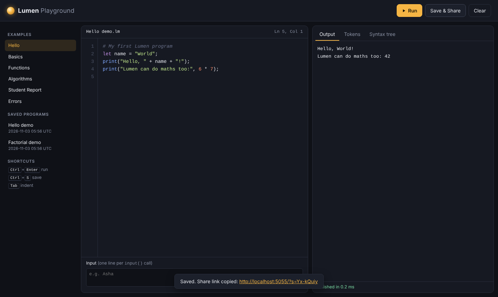

### Terminal

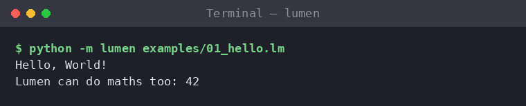
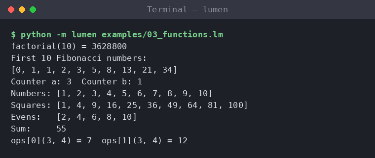
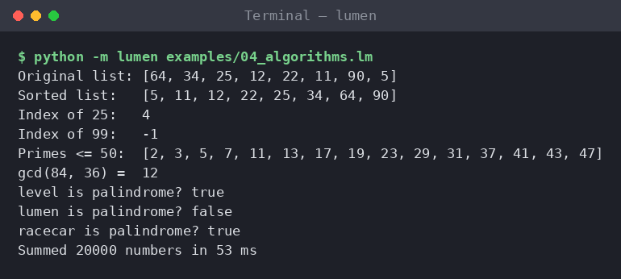
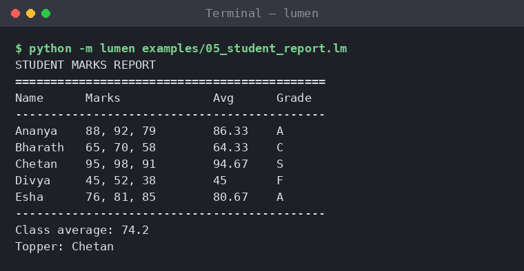
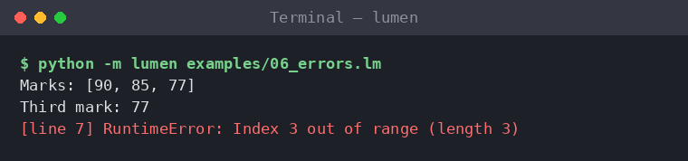
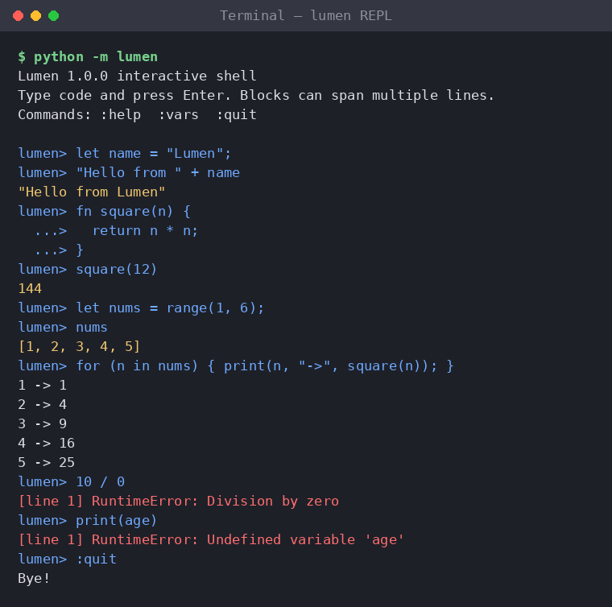
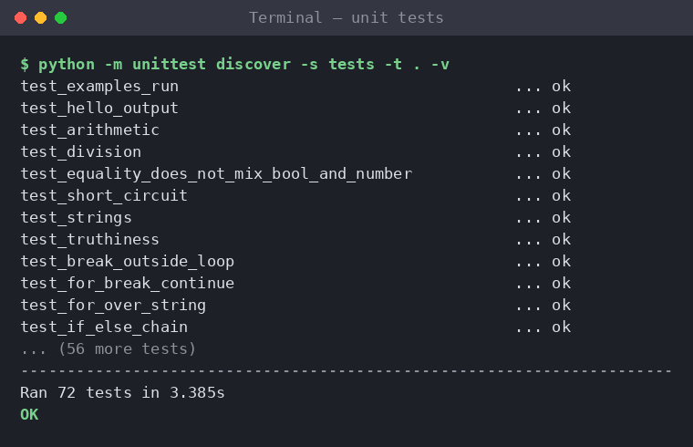

## Testing

**72 unit tests** in five groups:

| File                        | What it checks |
|-----------------------------|----------------|
| `tests/test_web.py`         | Every API endpoint, input, error lines, infinite-loop and output limits, bad requests, saving/loading, SQL injection |
| `tests/test_interpreter.py` | Arithmetic, scoping, loops, recursion, closures, lists, built-ins, runtime errors, time limit |
| `tests/test_parser.py`      | Precedence, associativity, functions, `if/else`, syntax errors |
| `tests/test_lexer.py`       | Tokens, operators, numbers, strings, comments, line numbers |
| `tests/test_examples.py`    | Every program in `examples/` runs correctly |

```bash
python -m unittest discover -s tests -t . -v
```

## Future Enhancements

- User accounts and login, so each user has their own saved programs
- Deploy the playground online (for example on Render or PythonAnywhere)
- Dictionaries, string methods and `import` in the language
- Step-through debugger that highlights each line as it runs

## License

This project is licensed under the MIT License. See [LICENSE](LICENSE).
