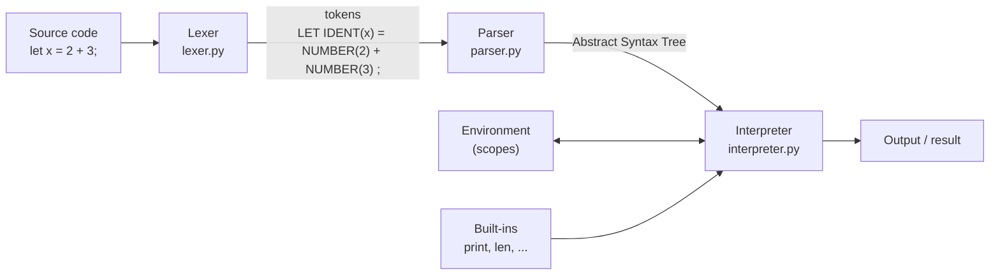
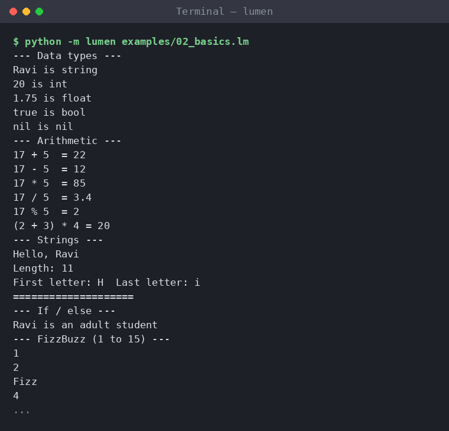
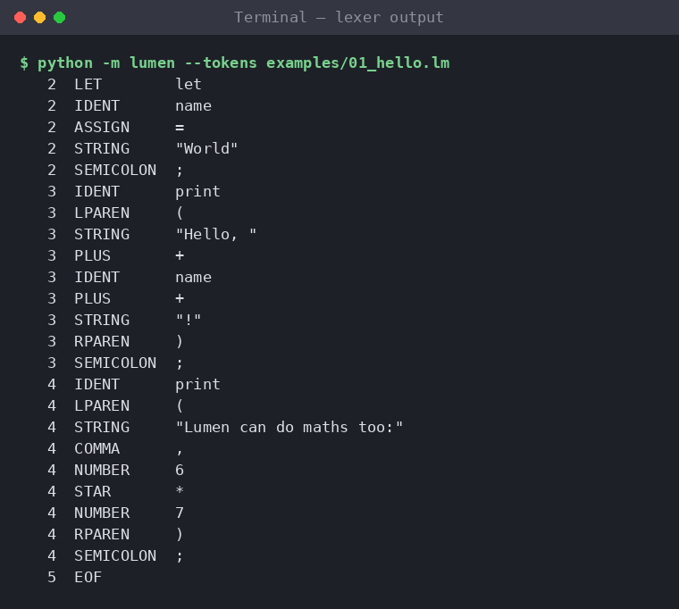

# Lumen: A Mini Programming Language Interpreter


**Lumen** is a small, dynamically typed programming language with its own interpreter, written from scratch in pure Python. It has variables, functions, recursion, closures, lists, loops, an interactive shell (REPL), and clear error messages with line numbers.

```
fn factorial(n) {
    if (n <= 1) { return 1; }
    return n * factorial(n - 1);
}
print("10! =", factorial(10));      # 10! = 3628800
```

---

## Table of Contents

1. [Objective](#objective)
2. [Project Description](#project-description)
3. [Features](#features)
4. [Tools and Technologies](#tools-and-technologies)
5. [How It Works](#how-it-works)
6. [Project Structure](#project-structure)
7. [Execution Steps](#execution-steps)
8. [Output](#output)
9. [Testing](#testing)
10. [Future Enhancements](#future-enhancements)

---

## Objective

- Understand how programming languages work internally by building one end to end.
- Apply core Computer Science concepts from Compiler Design, Data Structures and Theory of Computation: **lexical analysis, context-free grammars, recursive-descent parsing, abstract syntax trees, scoping and tree-walking evaluation**.
- Produce a working, tested and documented tool that can run real programs such as sorting, searching and report generation.

## Project Description

Every programming language you use, whether Python, Java or JavaScript, follows the same pipeline: source code is broken into **tokens**, the tokens are arranged into a **syntax tree** according to a **grammar**, and the tree is then **executed**. Lumen implements this whole pipeline in around 1,400 lines of readable, commented Python with no external libraries.

A Lumen program is a plain text file (`.lm`). The interpreter can:

- **Run a file:** `python -m lumen program.lm`
- **Start an interactive shell:** `python -m lumen`
- **Show the internal stages** for learning: `--tokens` prints the lexer output and `--ast` prints the parse tree.

The language design takes ideas from Python (truthiness, negative indexing, `for ... in`) and from C/JavaScript (braces, semicolons, `fn` expressions). The full reference is in [docs/LANGUAGE_GUIDE.md](docs/LANGUAGE_GUIDE.md).

## Features

| Category        | What Lumen supports |
|-----------------|---------------------|
| Data types      | `int`, `float`, `string`, `bool`, `nil`, `list`, `function` |
| Variables       | `let` declarations, reassignment, block scoping, shadowing |
| Operators       | `+ - * / %`, comparisons, `== !=`, `and or not`, correct precedence and associativity |
| Control flow    | `if / else if / else`, `while`, `for (x in list)`, `break`, `continue` |
| Functions       | Named and anonymous functions, recursion, **closures**, higher-order functions |
| Lists           | Literals, indexing (including negative), index assignment, nesting, `+` and `*` |
| Built-ins       | `print input len str int float type range push pop join split sqrt abs clock` |
| Error handling  | Syntax and runtime errors with **line numbers** and hints; stack-overflow protection |
| Tooling         | REPL with multi-line input, `:vars`, `:help`; `--tokens` and `--ast` debug views |

## Tools and Technologies

| Tool                | Purpose |
|---------------------|---------|
| **Python 3.8+**     | Implementation language (standard library only, no dependencies) |
| `dataclasses`, `enum` | AST node and token type definitions |
| `unittest`          | 55 automated tests for the lexer, parser, interpreter and examples |
| `argparse`          | Command-line interface |
| **Git and GitHub**  | Version control and project hosting |
| VS Code             | Development environment |

## How It Works



**1. Lexer (`lumen/lexer.py`).** Reads the source one character at a time and groups characters into tokens such as keywords, identifiers, numbers, strings and operators. It skips whitespace and comments, handles two-character operators like `<=` and `==`, processes string escape sequences, and records the line number of every token.

**2. Parser (`lumen/parser.py`).** A **recursive-descent parser** with one method per grammar rule. Operator precedence comes from the grammar itself: `term` calls `factor`, which calls `unary`, so `*` binds tighter than `+`. The output is an Abstract Syntax Tree built from the classes in `lumen/ast_nodes.py`. For example, `1 + 2 * 3` becomes:

```
      Binary(+)
      /       \
 Literal(1)  Binary(*)
             /       \
       Literal(2)  Literal(3)
```

**3. Interpreter (`lumen/interpreter.py`).** Walks the tree recursively. Each node type has its own `eval_*` or `exec_*` method. Some design decisions:

- **Scopes** form a linked chain of `Environment` objects. Variable lookup walks outwards, which gives lexical scoping.
- **Closures**: a function value stores the environment it was created in, so inner functions keep access to outer variables even after the outer function returns.
- **`return`, `break` and `continue`** are implemented as Python exceptions that unwind to the enclosing function or loop.
- **Safety**: runtime type checks give clear errors (`Cannot add string and int (hint: use str() to convert)`), and a call-depth limit turns infinite recursion into a readable "Stack overflow" message.

## Project Structure

```
.
├── lumen/                  # The interpreter package
│   ├── __main__.py         # CLI: run files, REPL, --tokens / --ast
│   ├── tokens.py           # Token types and keywords
│   ├── lexer.py            # Source text  -> tokens
│   ├── ast_nodes.py        # AST node classes
│   ├── parser.py           # Tokens       -> AST (recursive descent)
│   ├── interpreter.py      # AST          -> execution
│   ├── environment.py      # Variable scopes
│   ├── values.py           # Runtime values, truthiness, equality, printing
│   ├── builtins.py         # Built-in functions
│   └── errors.py           # Error classes with line numbers
├── examples/               # Sample Lumen programs
├── tests/                  # Unit tests (unittest)
├── screenshots/            # Output screenshots
├── docs/LANGUAGE_GUIDE.md  # Full language reference
└── README.md
```

## Execution Steps

**Prerequisite:** Python 3.8 or newer. Check with `python --version` (on some systems use `python3`).

```bash
# 1. Clone the repository
git clone https://github.com/TheOne-ship/hello.git
cd hello

# 2. Run an example program
python -m lumen examples/01_hello.lm

# 3. Try the other examples
python -m lumen examples/04_algorithms.lm
python -m lumen examples/05_student_report.lm

# 4. Start the interactive shell (type :quit to exit)
python -m lumen

# 5. See what the lexer and parser produce
python -m lumen --tokens examples/01_hello.lm
python -m lumen --ast examples/01_hello.lm

# 6. Run the test suite
python -m unittest discover -s tests -t .
```

No `pip install` is needed.

**Write your own program:** create a file such as `myprog.lm`:

```
let name = input("What is your name? ");
print("Welcome to Lumen, " + name + "!");
```

and run it with `python -m lumen myprog.lm`.

## Output

### Hello World


### Variables, operators and control flow (`02_basics.lm`)


### Recursion, closures and higher-order functions (`03_functions.lm`)


### Algorithms: bubble sort, binary search, Sieve of Eratosthenes, GCD (`04_algorithms.lm`)


### Practical program: student marks report (`05_student_report.lm`)


### Error reporting with line numbers (`06_errors.lm`)


### Interactive shell (REPL)


### Lexer output (`--tokens`)


### Unit tests


## Testing

The project has **55 unit tests** in four groups:

| File                        | What it checks |
|-----------------------------|----------------|
| `tests/test_lexer.py`       | Tokens, operators, numbers, strings and escapes, comments, line numbers, lexical errors |
| `tests/test_parser.py`      | Precedence, associativity, functions, `if/else`, syntax errors |
| `tests/test_interpreter.py` | Arithmetic, scoping, loops, recursion, closures, lists, built-ins, runtime errors |
| `tests/test_examples.py`    | Every program in `examples/` runs correctly |

```bash
python -m unittest discover -s tests -t . -v
```

## Future Enhancements

- Dictionaries / hash maps and string methods
- `import` to split programs across files
- Compile to bytecode and run on a stack-based virtual machine for speed
- Syntax highlighting extension for VS Code
- Classes and objects

## License

This project is licensed under the MIT License. See [LICENSE](LICENSE).
